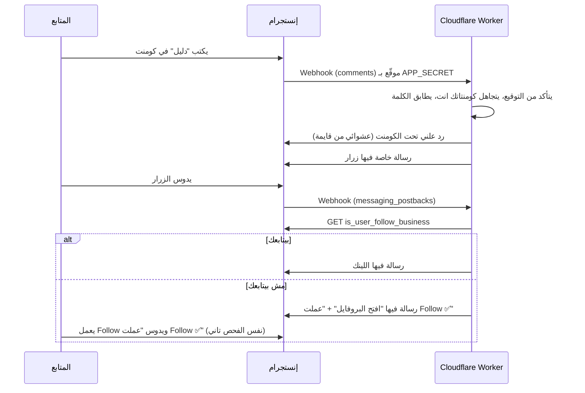

# ig-comment-dm

أتمتة إنستجرام: حد يكتب **كلمة مفتاحية في الكومنتات** ← بوت يرد عليه **علنًا** ويبعتله **رسالة خاصة بلينك**، بس **بعد ما يعمل Follow**. شغال على Cloudflare Worker، **ببلاش** على الخطة المجانية، ومن غير سيرفر.

مثال: حد كتب `دليل` على الريل بتاعك. البوت يرد تحت الكومنت "شيك على الـ DM 📩" ويبعتله رسالة فيها زرار. لما يدوس على الزرار: لو بيتابعك يوصله اللينك. لو مش بيتابعك يوصله زرارين "افتح البروفايل" و "عملت Follow ✅" ويجرب تاني.

> عايز AI agent يعمل الإعداد ده بدالك؟ افتح الفولدر في Claude Code أو Codex أو Cursor أو Gemini CLI والزق محتوى [`PROMPT.md`](PROMPT.md). الـ agent بيمشي على [`AGENTS.md`](AGENTS.md). النسخة الإنجليزي: [`README.md`](README.md).

## الفلو



## التكلفة

- Cloudflare Workers المجاني: 100,000 طلب في اليوم. البوت بيستهلك جزء صغير جدًا.
- Instagram API من Meta: مجاني.
- مفيش داتابيز ولا cron ولا storage.

## محتاج إيه

- حساب إنستجرام **Professional** (Business أو Creator). من التطبيق: Settings ← Account type and tools ← Switch to professional account.
- حساب مجاني على [Meta for Developers](https://developers.facebook.com).
- حساب مجاني على [Cloudflare](https://dash.cloudflare.com/sign-up).
- Node.js 20 أو أحدث (`node -v`).

## 1. نزّل الكود وظبّطه

```bash
git clone <this repo> ig-comment-dm   # أو نزّل ZIP
cd ig-comment-dm
npm install
```

افتح `src/index.js`. كل اللي هتعدله في البلوك اللي فوق:

| البلوك | بيعمل إيه |
|---|---|
| `LINKS` | المفتاح ← اللينك اللي هيوصل للناس |
| `KEYWORDS` | الكلمات في الكومنت ← المفتاح (مش حساسة لحروف كبيرة/صغيرة، ضيف عربي وأخطاء إملائية) |
| `WHOLE_WORD` | مفاتيح لازم تكون كلمة لوحدها (عشان `AREA` ماتفعّلش `REA`) |
| `COPY` | لكل مفتاح: `replies` (الرد العلني، بيتاخد عشوائي)، `card`، `button`، `gate`، `follow`، `followed`، `done(link)`. أي حاجة ناقصة بتاخد من `default` |

حدود إنستجرام: **عنوان الزرار 20 حرف بالكتير**، عنوان الكارت 80، نص الرسالة 1000.

بعدين شغّل الاختبارات (من غير إنترنت):

```bash
npm test      # لازم يطبع: all tests pass
```

## 2. إعداد Meta (حاجات انت بس اللي تعملها بالكليكات)

الأسماء من وثائق Meta لـ **Instagram API with Instagram Login**. Meta بتغيّر أماكن الأزرار، فلو الاسم مختلف دوّر على أقرب واحد.

1. ادخل <https://developers.facebook.com/apps> ← **Create app**. اختار نوع **Business**.
2. جوه الأب: **Add product ← Instagram**، وافتح **API setup with Instagram login**.
3. **Add account**: سجّل بحساب إنستجرام الـ professional ووافق على الصلاحيات. المطلوب:
   - `instagram_business_basic`
   - `instagram_business_manage_comments`
   - `instagram_business_manage_messages`
4. دوس **Generate token** للحساب. التوكن اللي بيتعمل من الداشبورد **long-lived (60 يوم)**. انسخه: ده `IG_TOKEN`. ماتبعتوش في شات ولا ترفعه على git.
5. هات رقم حسابك (`IG_USER_ID`): بيظهر جنب الحساب، أو من `GET https://graph.instagram.com/v21.0/me?fields=user_id,username` بالتوكن. اسم الحساب من غير `@` هو `IG_USERNAME`.
6. انسخ **Instagram app secret** من نفس صفحة API setup. ده `APP_SECRET`. (ملحوظة: مع Instagram Login ممكن يكون مختلف عن الـ "App secret" في App settings ← Basic. التوقيع بيستخدم الـ Instagram app secret. لو طلع 401 جرّب التاني.)
7. اخترع كلمة سر عشوائية (24 حرف مثلًا). دي `VERIFY_TOKEN`.
8. سيب التاب مفتوح، هترجعله بعد الـ deploy.

## 3. إعداد Cloudflare والـ deploy

```bash
npx wrangler login                    # بيفتح المتصفح، سجّل دخول Cloudflare
npx wrangler secret put APP_SECRET    # الزق القيمة لما يسألك
npx wrangler secret put IG_TOKEN
npx wrangler secret put IG_USER_ID
npx wrangler secret put IG_USERNAME
npx wrangler secret put VERIFY_TOKEN
npm run deploy
```

الـ deploy هيطبع اللينك، زي `https://ig-comment-dm.<your-subdomain>.workers.dev`. (أول `secret put` ممكن يسألك تعمل الـ Worker، وافق.)

اتأكد:

- `https://<your-url>/health` ← `{"ok":true,"username":"yourhandle",...}`. لو `ok` بـ false يبقى التوكن غلط أو خلص.
- `https://<your-url>/privacy` ← صفحة الخصوصية. Meta محتاجاها.

## 4. وصّل الـ Webhook

ارجع Meta ← **API setup with Instagram login** ← **Configure webhooks**:

1. **Callback URL**: لينك الـ Worker (الجذر).
2. **Verify token**: نفس `VERIFY_TOKEN`. دوس **Verify and save**. لو فشل، اعمل deploy تاني وراجع الـ secret.
3. اشترك في الـ fields: **`comments`** و **`messaging_postbacks`**.
4. اتأكد إن حساب إنستجرام **متفعّل عليه الاشتراك** (التوجل جنب الحساب). أو بالـ API: `POST https://graph.instagram.com/v21.0/me/subscribed_apps?subscribed_fields=comments,messaging_postbacks` مع `Authorization: Bearer <IG_TOKEN>`.
5. شوف `/health`: `webhook_fields` لازم يظهر فيها `comments` و `messaging_postbacks`.

وكمان حط في **App settings ← Basic ← Privacy Policy URL** القيمة `https://<your-url>/privacy`.

## 5. وضع الأب والـ testers (مهم)

- **Development mode** (الافتراضي): الـ webhooks بتشتغل بس للناس اللي ليهم role على الأب (admin, developer, tester). ضيف حساب إنستجرام تاني كـ **Instagram Tester** (App roles ← Roles، وبعدين اقبل الدعوة من إنستجرام: Settings ← Apps and websites ← Tester invites) وجرّب بيه.
- **Live mode**: ده المطلوب للجمهور. حوّل الأب لـ Live (محتاج Privacy Policy URL وأيقونة وكاتيجوري). استخدام الصلاحيات دي مع ناس مش على الأب غالبًا بيحتاج **Advanced Access عن طريق Meta App Review**، وبيطلبوا فيديو للفلو. راجع وثائق Meta الحالية. احسب حسابك، ممكن ياخد كام يوم.

## 6. جرّبه

1. من حساب الـ tester اكتب `دليل` (أو أي كلمة عملتها) في كومنت على بوست ليك.
2. المفروض يظهر رد علني ورسالة خاصة فيها زرار.
3. دوس الزرار. لو مش بتتابعه: بوابة الـ Follow. اتابع، دوس "عملت Follow ✅" ← يوصلك اللينك.
4. لو مفيش حاجة حصلت: Cloudflare dashboard ← الـ Worker بتاعك ← **Logs**. أخطاء إنستجرام بتتسجل `IG error ...`.

## ضيف كلمة جديدة

1. `LINKS`: ضيف `PRICING: "https://..."`.
2. `KEYWORDS`: ضيف `PRICING: "PRICING"` ومرادفاتها زي `"الأسعار": "PRICING"`.
3. اختياري: `COPY.PRICING = { ... }` لنصوص مخصوصة، وإلا بتتاخد النصوص الافتراضية.
4. `npm test` وبعدين `npm run deploy`.

أول تطابق بيكسب حسب ترتيب `KEYWORDS`. حط الكلمات الأطول أو الأدق الأول.

## حل المشاكل

| المشكلة | السبب / الحل |
|---|---|
| "Verify and save" بيفشل | `VERIFY_TOKEN` مختلف عن اللي كتبته في Meta، أو الـ Worker مش متعمله deploy. افتح اللينك بـ `?hub.verify_token=<token>&hub.challenge=1` لازم يطبع `1`. |
| الكومنتات بتوصل والـ Worker بيرجّع 401 "bad sig" | `APP_SECRET` غلط. استخدم الـ Instagram app secret من API setup، وجرّب اللي في App settings ← Basic. |
| مفيش webhook خالص | الحساب مش مشترك، أو الـ field `comments` مش متفعل، أو الأب في Development والمعلّق مالوش role. |
| `IG error ... "Invalid OAuth access token"` (code 190) | التوكن خلص أو اتلغى. اعمل واحد جديد و `wrangler secret put IG_TOKEN`. |
| `(#10)` / `(#200)` مفيش صلاحية | ناقص صلاحية (`instagram_business_manage_comments` أو `instagram_business_manage_messages`)، أو الأب مالوش Advanced Access للناس برا الأب. |
| `(#100) ... Object with ID ... does not exist` عند الرسالة | الرد الخاص مسموح **خلال 7 أيام من الكومنت** و**مرة واحدة لكل كومنت**. وممكن الكومنت اتمسح. |
| الرد العلني شغال والـ DM لأ | الحساب لازم professional؛ إعدادات الرسايل عند الشخص أو تقييد الحساب ممكن يمنعوا؛ راجع `instagram_business_manage_messages`. |
| بوابة الـ Follow مش بتعدّي | جرّب بحساب بيتابعك فعلًا. |
| الزرار بيترفض | عنوان الزرار أكتر من 20 حرف. قصّره. |
| البوت بيرد على نفسه | `IG_USER_ID` / `IG_USERNAME` غلط. |

### نافذة الـ 24 ساعة

إنستجرام بيسمح **برد خاص واحد** لكل كومنت (خلال 7 أيام). بعد ما الشخص يدوس الزرار تقدر تبعتله رسايل لمدة **24 ساعة** من التفاعل ده. رسالة اللينك ورسالة بوابة الـ Follow بتحصل بعد الدوسة على طول فهي جوه النافذة. مينفعش تبعت لحد برا النافذة بعدين.

### انتهاء التوكن (كل حوالي 60 يوم)

التوكن الـ long-lived صالح 60 يوم. جدّده **قبل ما يخلص** وبعد 24 ساعة على الأقل من إصداره:

```bash
curl "https://graph.instagram.com/refresh_access_token?grant_type=ig_refresh_token&access_token=<IG_TOKEN>"
```

الرد فيه `access_token` جديد (60 يوم تانيين). حطه بـ `npx wrangler secret put IG_TOKEN`. لو خلص خلاص، اعمل واحد جديد من الداشبورد. حط تذكير كل 50 يوم. `/health` بيقولك لو التوكن لسه شغال.

## الملفات

- `src/index.js`: الـ Worker كله (بلوك الإعدادات فوق)
- `test.mjs`: اختبارات أوفلاين (`npm test`)
- `wrangler.toml`: إعدادات الـ Worker
- `AGENTS.md`, `PROMPT.md`: تعليمات لـ AI agents

## الخصوصية والقواعد

الـ Worker مبيخزنش حاجة. بيعالج الكومنت، والـ ID واسم المستخدم عند إنستجرام، وهل بيتابعك ولا لأ. التزم بـ [شروط منصة Meta](https://developers.facebook.com/terms) ومتعملش سبام. رخصة MIT.
