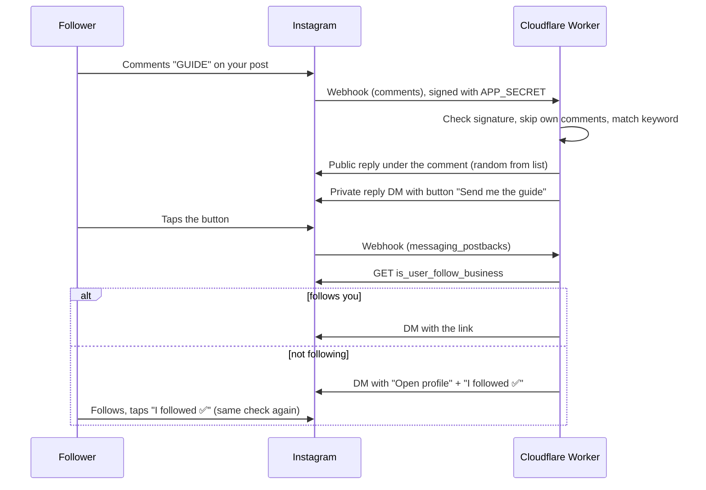

# ig-comment-dm

Instagram **comment keyword → public reply + DM with a link**, gated behind "follow me first". Runs on a Cloudflare Worker, costs **$0** on the free tier, no server to maintain.

Someone comments `GUIDE` on your reel. The bot replies under the comment ("Check your DMs 📩") and DMs them a button. They tap it. If they follow you, they get the link. If not, they get "Open profile" and "I followed ✅" buttons and can try again.

> Want an AI agent to set this up for you? Open this folder in Claude Code, Codex, Cursor, Gemini CLI or similar and paste the contents of [`PROMPT.md`](PROMPT.md). The agent follows [`AGENTS.md`](AGENTS.md). Arabic version of this guide: [`README.ar.md`](README.ar.md).

## Flow



## Cost

- Cloudflare Workers free plan: 100,000 requests/day. A comment bot uses a tiny fraction.
- Meta Instagram API: free.
- No database, no cron, no storage.

## What you need

- An Instagram **professional account** (Business or Creator), switched in the Instagram app: Settings → Account type and tools → Switch to professional account.
- A free [Meta for Developers](https://developers.facebook.com) account.
- A free [Cloudflare](https://dash.cloudflare.com/sign-up) account.
- Node.js 20+ (`node -v`).

## 1. Get the code and configure it

```bash
git clone <this repo> ig-comment-dm   # or download the ZIP
cd ig-comment-dm
npm install
```

Open `src/index.js`. Everything you edit is in the block at the top:

| Block | What it does |
|---|---|
| `LINKS` | key → the link people receive |
| `KEYWORDS` | words in a comment → key (case-insensitive; add Arabic, typos, variants) |
| `WHOLE_WORD` | keys that must stand alone (so `AREA` does not trigger `REA`) |
| `COPY` | per key: `replies` (public reply, random pick), `card`, `button`, `gate`, `follow`, `followed`, `done(link)`. Missing fields fall back to `default` |

Instagram limits: **button titles max 20 characters**, card title max 80, DM text max 1000.

Then run the offline tests (no network needed):

```bash
npm test      # prints: all tests pass
```

## 2. Meta setup (clicks only you can do)

Names below are from Meta's docs for **Instagram API with Instagram Login**. Meta moves buttons around, so if a label differs, look for the closest one.

1. Go to <https://developers.facebook.com/apps> → **Create app**. Choose the **Business** app type (use case "Other" / business if asked).
2. In the app dashboard, **Add product → Instagram**, then open **API setup with Instagram login**.
3. **Add account**: log in with your professional Instagram account and approve the permissions. Required permissions:
   - `instagram_business_basic`
   - `instagram_business_manage_comments`
   - `instagram_business_manage_messages`
4. Click **Generate token** for your account. Tokens generated in the dashboard are **long-lived (60 days)**. Copy it: this is `IG_TOKEN`. Never paste it in a chat or commit it.
5. Note your Instagram account ID (shown next to the account; also returned by `GET https://graph.instagram.com/v21.0/me?fields=user_id,username` with the token). That is `IG_USER_ID`. Your handle without `@` is `IG_USERNAME`.
6. Copy the **Instagram app secret** from the same API setup page. This is `APP_SECRET`. (Note: with Instagram Login, this can be a different value from the main "App secret" under App settings → Basic. Webhook signatures use the Instagram app secret. If signatures fail with 401, try the other one.)
7. Invent a random string, for example 24 random characters. This is `VERIFY_TOKEN`.
8. Leave this tab open. You come back after deploying to set up the webhook.

## 3. Cloudflare setup and deploy

```bash
npx wrangler login                    # opens your browser, log in to Cloudflare
npx wrangler secret put APP_SECRET    # paste value when asked
npx wrangler secret put IG_TOKEN
npx wrangler secret put IG_USER_ID
npx wrangler secret put IG_USERNAME
npx wrangler secret put VERIFY_TOKEN
npm run deploy
```

The deploy prints your URL, like `https://ig-comment-dm.<your-subdomain>.workers.dev`. (The first `secret put` may offer to create the Worker; say yes.)

Check it:

- `https://<your-url>/health` → `{"ok":true,"username":"yourhandle",...}`. If `ok` is false, the token is wrong or expired.
- `https://<your-url>/privacy` → a simple privacy page. Meta needs this URL.

## 4. Connect the webhook

Back in Meta → **API setup with Instagram login** → **Configure webhooks**:

1. **Callback URL**: your Worker URL (the root, for example `https://ig-comment-dm.<sub>.workers.dev`).
2. **Verify token**: the same `VERIFY_TOKEN` you set. Click **Verify and save**. If it fails, redeploy and check the secret.
3. Subscribe to the fields **`comments`** and **`messaging_postbacks`**.
4. Make sure your Instagram account is **subscribed** (toggle next to the account). The same can be done by API: `POST https://graph.instagram.com/v21.0/me/subscribed_apps?subscribed_fields=comments,messaging_postbacks` with `Authorization: Bearer <IG_TOKEN>`.
5. Check `/health`: `webhook_fields` should list `comments` and `messaging_postbacks`.

Also fill in **App settings → Basic → Privacy Policy URL** with `https://<your-url>/privacy`.

## 5. App mode and testers (important)

- **Development mode** (default): webhooks only fire for people who have a role on the app (admin, developer, tester). Add a second Instagram account as an **Instagram Tester** (App roles → Roles, then accept the invite in Instagram: Settings → Apps and websites → Tester invites) and test with that account.
- **Live mode**: needed for the public. Toggle the app to Live (requires the privacy policy URL, app icon, category). Using these permissions for people who are not on your app typically requires **Advanced Access via Meta App Review**. Review needs a screencast of the flow. Check Meta's current App Review docs for what they ask. Plan for this: it can take days.

## 6. Test it

1. From your tester account, comment `GUIDE` on one of your posts.
2. You should see a public reply and a DM with a button.
3. Tap the button. Not following → you get the follow gate. Follow, tap "I followed ✅" → you get the link.
4. If nothing happens: Cloudflare dashboard → your Worker → **Logs**. Errors from Instagram are logged as `IG error ...`.

## Add or change a keyword

1. `LINKS`: add `PRICING: "https://..."`.
2. `KEYWORDS`: add `PRICING: "PRICING"` and variants such as `"الأسعار": "PRICING"`.
3. Optional: `COPY.PRICING = { ... }` for custom texts. Otherwise the default texts are used.
4. `npm test`, then `npm run deploy`.

First match wins, in the order of `KEYWORDS`. Put longer or more specific words first.

## Troubleshooting

| Symptom | Cause / fix |
|---|---|
| Webhook "Verify and save" fails | `VERIFY_TOKEN` secret differs from what you typed in Meta, or the Worker is not deployed. Open the URL with `?hub.verify_token=<token>&hub.challenge=1`: it must print `1`. |
| Comments arrive, Worker returns 401 "bad sig" | Wrong `APP_SECRET`. Use the Instagram app secret from API setup; try the app secret from App settings → Basic if that fails. |
| No webhook at all | Account not subscribed, field `comments` not subscribed, or app in Development mode and the commenter has no role on the app. |
| `IG error ... "Invalid OAuth access token"` (code 190) | Token expired or revoked. Generate a new one and `wrangler secret put IG_TOKEN`. |
| `(#10) Application does not have permission` / `(#200)` | Missing permission (`instagram_business_manage_comments` or `instagram_business_manage_messages`), or the app lacks Advanced Access for users outside your app. |
| `(#100) ... Object with ID ... does not exist` on the DM | The private reply is only allowed **within 7 days of the comment**, and **one per comment**. Also the comment may be deleted. |
| Public reply works, DM does not | Account must be professional; the user's DM settings or an account restriction can block messages; check `instagram_business_manage_messages`. |
| Follow gate never passes | `is_user_follow_business` needs the user to have interacted via DM (they tapped the button, so that is fine). Test with an account that really follows you. |
| Button text cut off or request rejected | Button title over 20 characters. Shorten it. |
| Bot replies to itself | `IG_USER_ID` / `IG_USERNAME` secrets wrong. |

### The 24-hour messaging window

Instagram allows **one** private reply per comment (within 7 days). After the person taps the button, you may send messages for **24 hours** after that interaction. The link DM and the follow-gate DM happen right after the tap, so they are inside the window. You cannot message someone out of the blue later.

### Token expiry (about every 60 days)

A long-lived token lasts 60 days. Refresh it **before it expires** and at least 24 hours after it was issued:

```bash
curl "https://graph.instagram.com/refresh_access_token?grant_type=ig_refresh_token&access_token=<IG_TOKEN>"
```

The response has a new `access_token` (valid another 60 days). Put it in with `npx wrangler secret put IG_TOKEN`. If it already expired, generate a new one from the dashboard. Put a calendar reminder every 50 days. `/health` tells you if the token still works.

## Files

- `src/index.js`: the whole Worker (config block at the top)
- `test.mjs`: offline tests (`npm test`)
- `wrangler.toml`: Worker config
- `AGENTS.md`, `PROMPT.md`: instructions for AI agents

## Privacy and rules

The Worker stores nothing. It processes the comment, the commenter's Instagram-scoped ID and username, and whether they follow you. Follow Instagram's [Platform Terms](https://developers.facebook.com/terms) and don't spam. MIT licensed.
